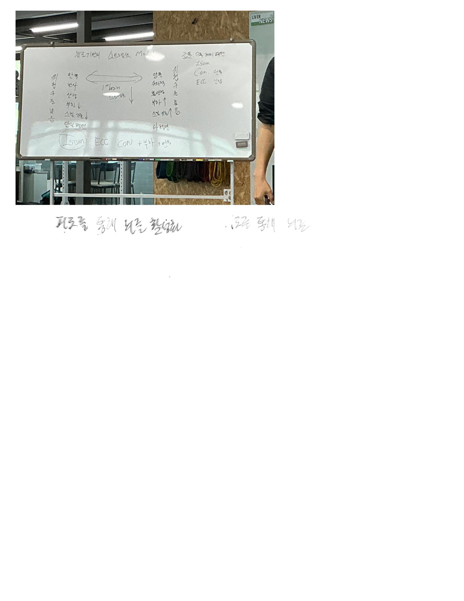

# 스트렝스 (1).pdf — 정리 및 읽기 안내

## 학습 목적

Goodnotes 자료를 기존 GitHub 노트와 구별해 검색하고 필요한 페이지를 찾아 읽는다.

## 핵심 내용

1쪽은 텍스트가 없고 2쪽은 강의 화이트보드 사진이다. Isom/Con/ECC와 부하·반복·속도·다양성 축이 보인다. 사진 일부 반사와 흐림 때문에 문장 전체를 확정하지 않았다. 자동 OCR은 매우 부정확하다.

## 근거와 출처

- 사용자 Goodnotes 뉴로 폴더 및 그 하위 폴더에서 2026-10-21 PDF 내보내기.
- 대표 내보내기 파일: `스트렝스 (1).pdf` (2쪽).
- PDF SHA-256: `31c1d256228f64aa5e1d15a2f80fa48929d7f2c95793cde7b9b82cacea0a9acb`.
- 문서 이름의 `(1)`은 내보내기 중복 파일명이며 새 개정판을 의미하지 않는다.

## 기존 자료와 비교

기존 저장소의 산후·다이어트 자료와 관련 주제가 겹칠 수 있으나 이 이름과 구성의 별도 강의안/필기는 기존 전체 파일 트리에서 확인되지 않아 추가했다.

## 페이지별 검색 자료

- [39_스트렝스_판서사진_01.md](Extracts/39_스트렝스_판서사진_01.md) — PDF 1–2쪽

## 도식 및 사진 원문 대조

### PDF 2쪽

## 한계와 반대 근거

이 노트는 강의 기록 보관용 초안이며 논문 검증을 하지 않았다. 손글씨·이미지·빈칸은 자동 인식이 부정확할 수 있다. 특정 자극→특정 뇌 부위→치료/성능 향상을 단정하는 표현은 원문 주장으로만 취급한다. 일괄 내보내기에서 일부 버전의 동기화 오류가 있어 최신 버전 전체의 완전성은 보장하지 않는다.

## 골프 또는 실전 적용

이번에는 자료를 보존·비교했으며 개별 운동·수기·호흡·영양 처방은 만들지 않았다.

## 미해결 질문

강의 원문 인용과 필기 작성자의 해석을 구분하고, 불분명한 글씨와 신경학적 효과 주장은 추가 검토가 필요하다.

## 다음 학습

관련 질문이 있을 때 해당 쪽을 원문 이미지 및 근거 자료와 다시 대조한다.
