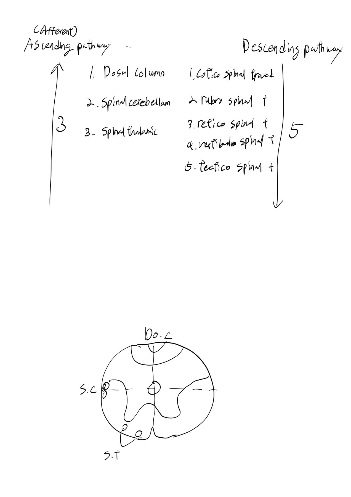
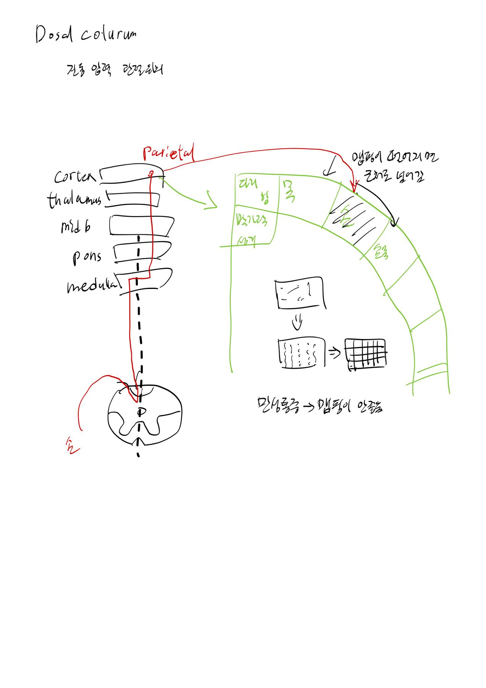
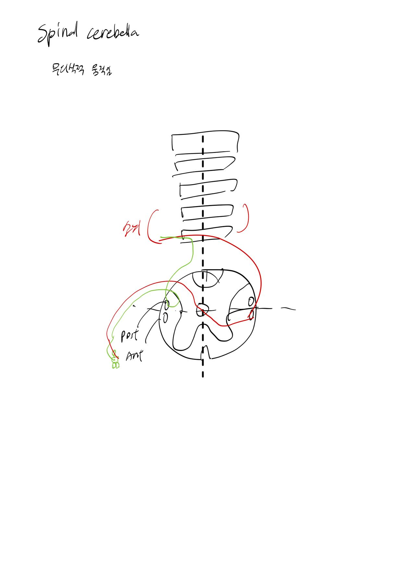
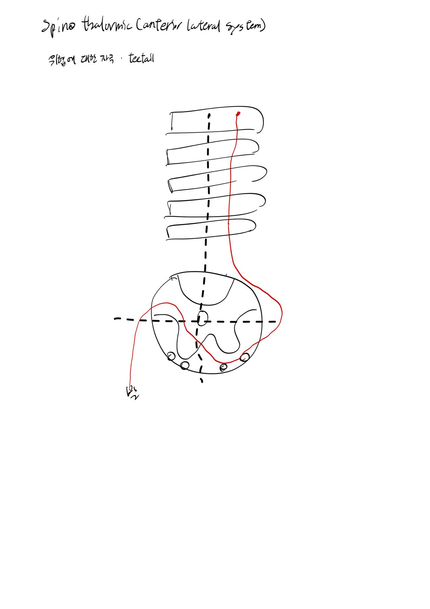
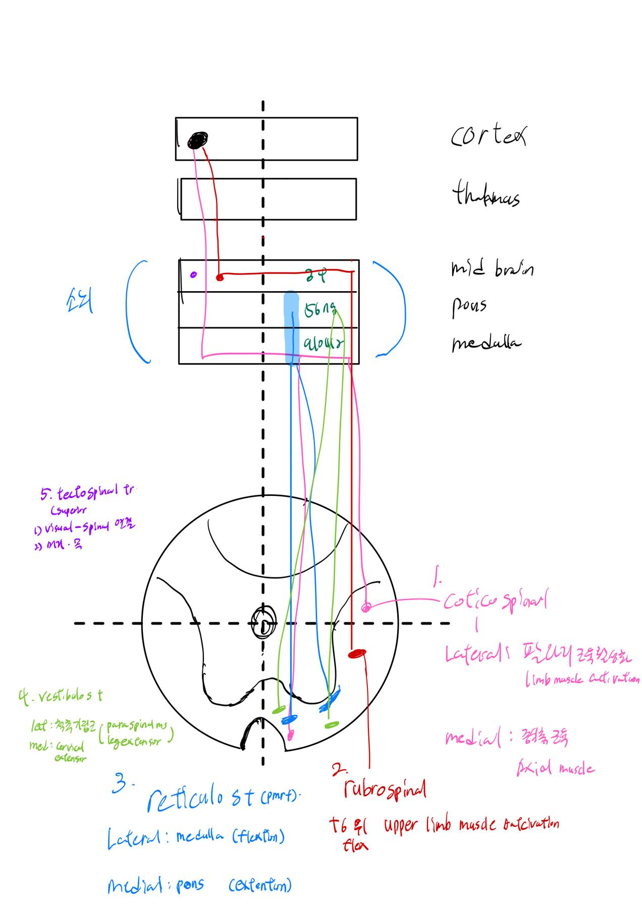
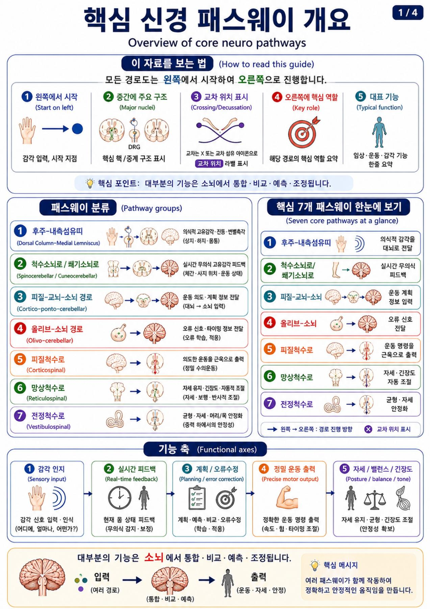
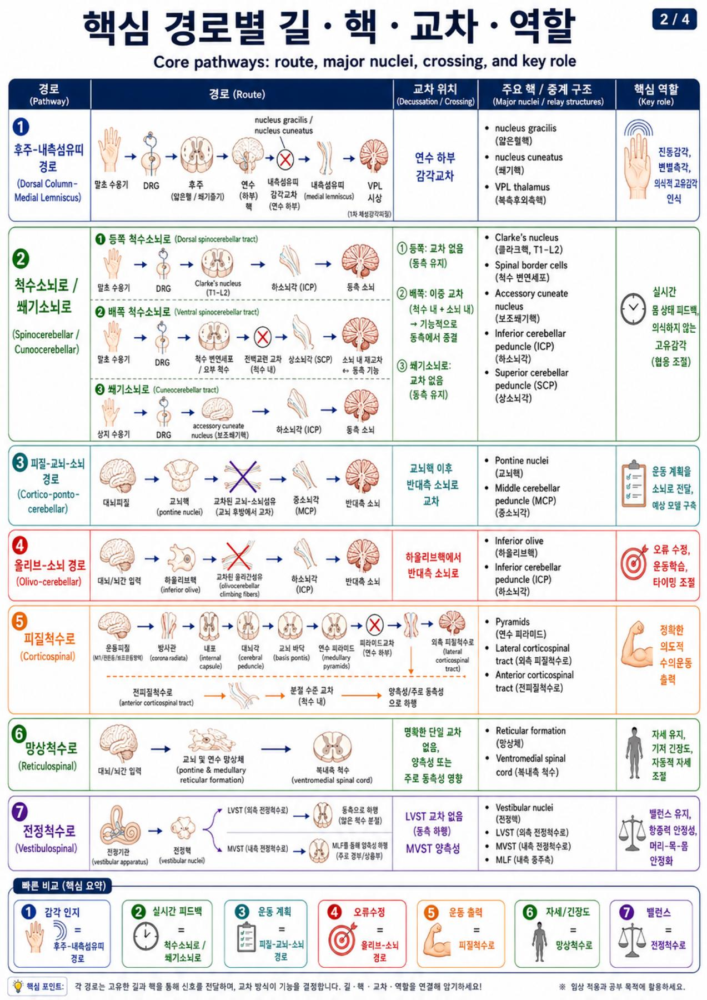
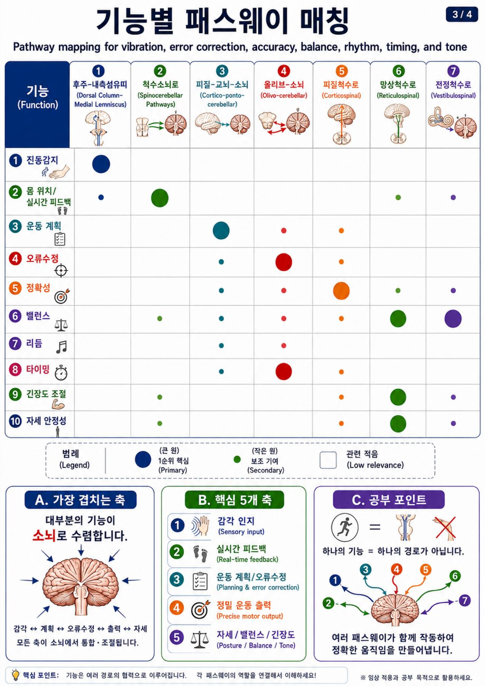
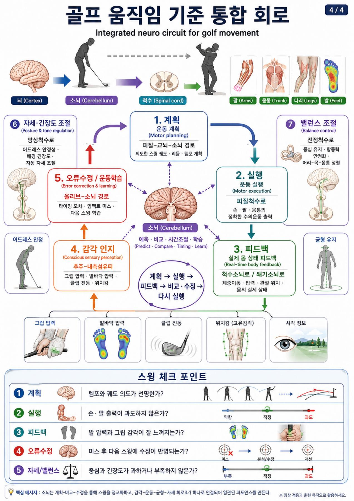

# 패스웨이 기본.pdf — 정리 및 읽기 안내

## 학습 목적

Goodnotes 자료를 기존 GitHub 노트와 구별해 검색하고 필요한 페이지를 찾아 읽는다.

## 핵심 내용

손글씨 상행·하행 신경로와 중계·교차 메모, 인쇄된 Neuro Pathways Study Guide 표, 뒤쪽 사진을 포함한다. 기존 2026-10-14 신경로 대화 요약과 겹치는 기본 개념은 유지하고 원문·도식을 추가한다. 인쇄 표의 작성자/생성 출처는 파일에서 확인되지 않는다.

## 근거와 출처

- 사용자 Goodnotes 뉴로 폴더 및 그 하위 폴더에서 2026-10-21 PDF 내보내기.
- 대표 내보내기 파일: `패스웨이 기본.pdf` (19쪽).
- PDF SHA-256: `ab2b8f5da78e2c96e06c75df36372c45a3501240b1e0ed2ce68a28a84e4c6506`.
- 문서 이름의 `(1)`은 내보내기 중복 파일명이며 새 개정판을 의미하지 않는다.

## 기존 자료와 비교

기존 CN I–XII·망상체·EWN·전정/신경로 대화 기록과 일반 개념 일부가 겹친다. 이번에는 해당 강의의 실제 페이지·필기·도식을 새로 보존한다.

## 페이지별 검색 자료

- [41_패스웨이기본_01.md](Extracts/41_패스웨이기본_01.md) — PDF 1–9쪽
- [41_패스웨이기본_02.md](Extracts/41_패스웨이기본_02.md) — PDF 10–15쪽
- [41_패스웨이기본_03.md](Extracts/41_패스웨이기본_03.md) — PDF 16–19쪽

## 도식 및 사진 원문 대조

### PDF 1쪽

### PDF 2쪽

### PDF 3쪽

### PDF 4쪽

### PDF 5쪽

### PDF 16쪽

### PDF 17쪽

### PDF 18쪽

### PDF 19쪽

## 한계와 반대 근거

이 노트는 강의 기록 보관용 초안이며 논문 검증을 하지 않았다. 손글씨·이미지·빈칸은 자동 인식이 부정확할 수 있다. 특정 자극→특정 뇌 부위→치료/성능 향상을 단정하는 표현은 원문 주장으로만 취급한다. 일괄 내보내기에서 일부 버전의 동기화 오류가 있어 최신 버전 전체의 완전성은 보장하지 않는다.

## 골프 또는 실전 적용

이번에는 자료를 보존·비교했으며 개별 운동·수기·호흡·영양 처방은 만들지 않았다.

## 미해결 질문

강의 원문 인용과 필기 작성자의 해석을 구분하고, 불분명한 글씨와 신경학적 효과 주장은 추가 검토가 필요하다.

## 다음 학습

관련 질문이 있을 때 해당 쪽을 원문 이미지 및 근거 자료와 다시 대조한다.
